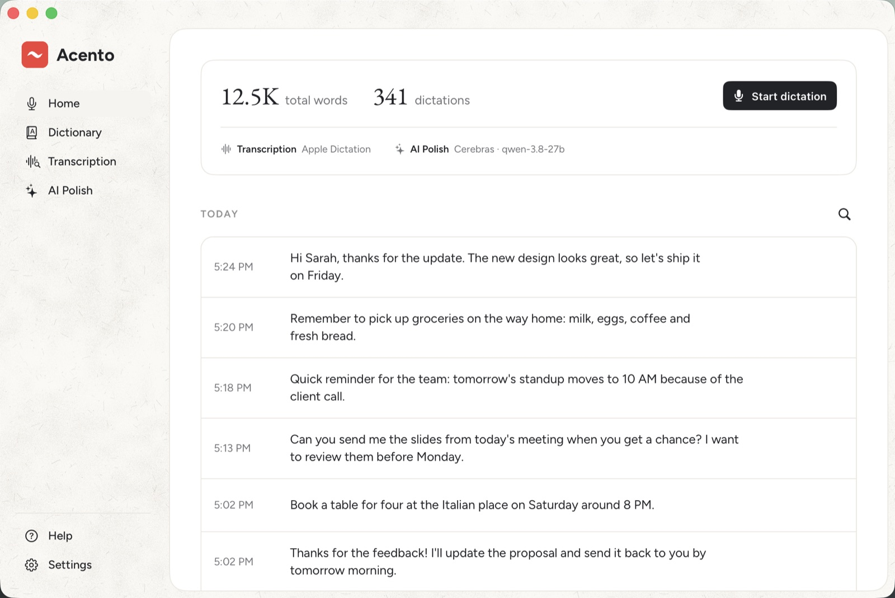
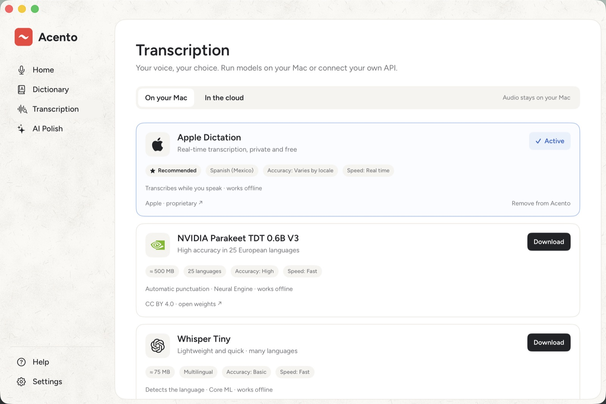
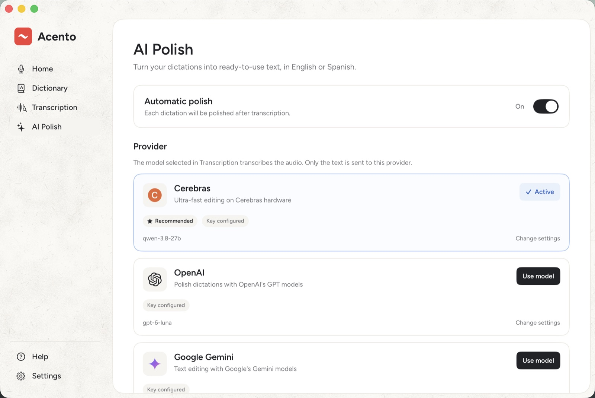
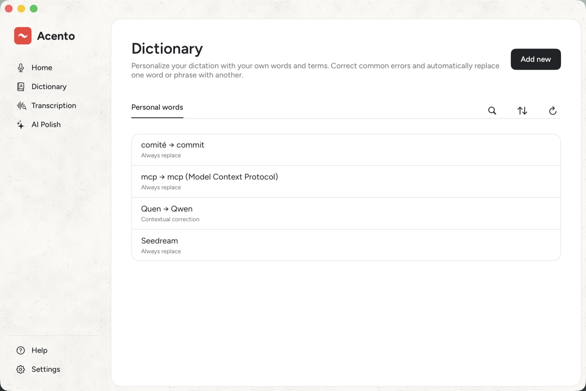
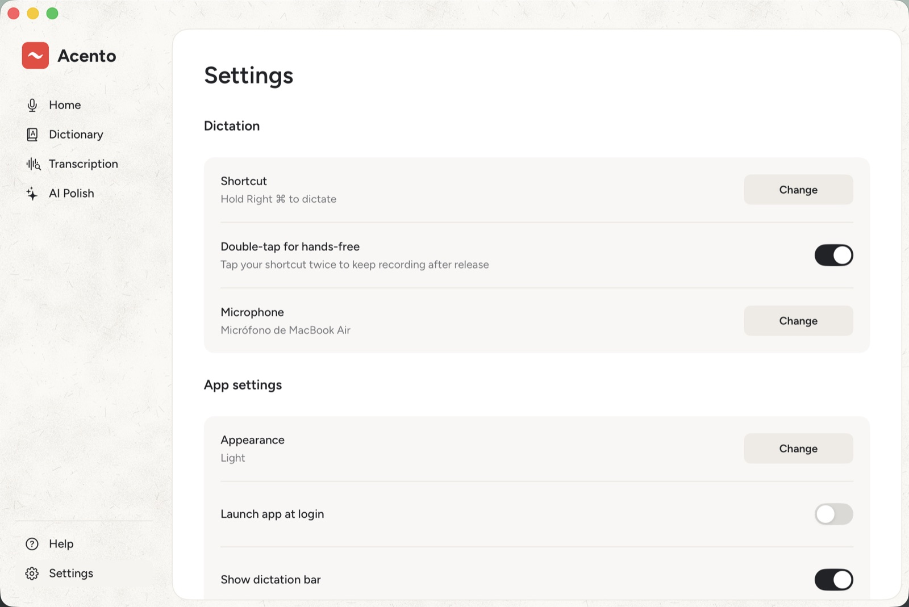

# Acento

A macOS dictation app with local speech models and optional bring-your-own-key cloud transcription. Built with SwiftUI for macOS 26 or later.

  

  
  

  
  

## What it does

- **Dictate anywhere.** Hold Right ⌘ to talk, release to paste the text where your cursor is. Double-tap for hands-free.
- **Local or cloud.** Use Apple Dictation, Parakeet or Whisper on your Mac, or bring your own key for Groq, OpenAI, Gemini or OpenRouter.
- **AI Polish.** Optionally cleans up punctuation and filler words with Cerebras, OpenAI, Gemini or OpenRouter. Write your own instructions if you like.
- **Personal dictionary.** Teach it names and words it keeps getting wrong.
- **History.** Every dictation is saved by day. Failed ones keep their audio so you can retry.
- **Floating bar.** A small capsule that shows when you're recording.
- **English and Spanish** interface.

## Install

Requires macOS 26 or later.

A signed download is coming soon in [Releases](https://github.com/AlphaNumericUser/Acento/releases). For now, build it yourself:

1. Open `Acento.xcodeproj` in Xcode.
2. Run the `Acento` scheme.

On first use, grant **Microphone** and **Accessibility** access so Acento can hear you and paste the text.

## Privacy

Local models run entirely on your Mac. Cloud providers only receive audio or text when you choose them, using your own API keys, which are stored in the macOS Keychain. Provider requests may incur charges.

## Feedback

Use **Help** inside the app, or [open an issue](https://github.com/AlphaNumericUser/Acento/issues).

## License

Acento is released under the [MIT License](LICENSE).

- Dependencies: [WhisperKit](https://github.com/argmaxinc/argmax-oss-swift) (MIT), [FluidAudio](https://github.com/FluidInference/FluidAudio) (Apache-2.0) and Hugging Face / Apple Swift packages (Apache-2.0).
- Fonts: Figtree and EB Garamond (SIL OFL 1.1).
- Provider logos: [Simple Icons](https://simpleicons.org/) (CC0).
- Sounds are original, synthesized by `Scripts/GenerateSounds.py`.
- Speech models are downloaded from their publishers and keep their own licenses.
