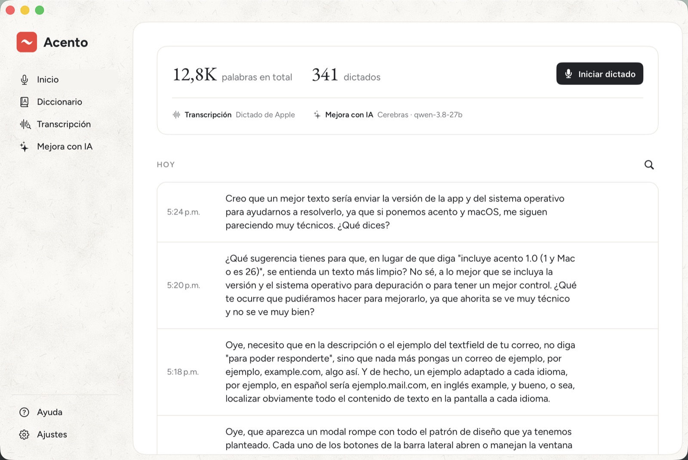
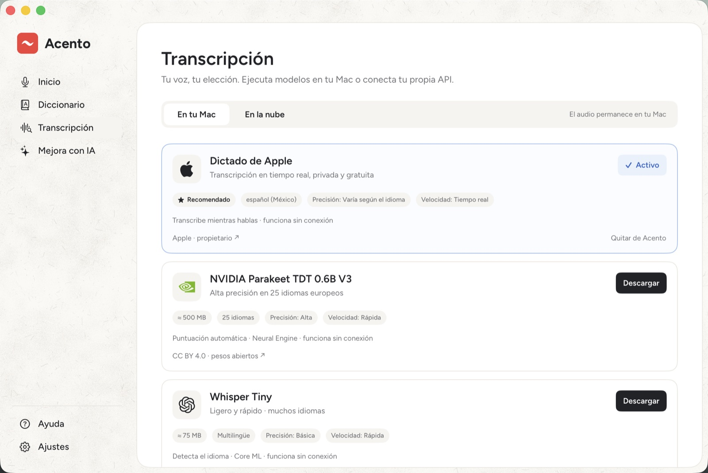

# Acento

A macOS dictation app with local speech models and optional bring-your-own-key cloud transcription. Built with SwiftUI for macOS 26 or later.

<p align="center">
  
</p>

<p align="center">
  
  
</p>

## Get started

Open `Acento.xcodeproj` in Xcode and run the `Acento` scheme. In **Transcription → On your Mac**, download a Parakeet or Whisper model, or select Apple Dictation without a separate download if macOS already supports on-device recognition for your language. Then use **Start dictation** or the shortcut configured in **Settings**. The transcript appears in **Home** and is inserted into the previously focused application when macOS Accessibility permission is granted. Otherwise it is copied to the clipboard.

**Transcription → In the cloud** offers Groq first (`whisper-large-v3-turbo` by default, or `whisper-large-v3` for higher accuracy, chosen in the provider editor), then OpenRouter (Gemini 2.5 Flash), Google Gemini (Gemini 2.5 Flash), and OpenAI (gpt-4o-mini-transcribe). Supply your own key; keys are stored in macOS Keychain. API dictations send recordings to the selected provider and may incur provider charges. Groq requests use `temperature=0`. Every API provider retries rate limits (HTTP 429) after 1, 2 and 4 seconds; if the provider stays rate-limited, rejects the key, has a server error, or is unreachable, a clear error is shown and the recording is kept for retry from history. Acento never switches to another model on its own. Local dictations process audio on the Mac; Parakeet and Whisper models download on demand from Hugging Face using [FluidAudio](https://github.com/FluidInference/FluidAudio) and [WhisperKit](https://github.com/argmaxinc/argmax-oss-swift). Apple Dictation uses the macOS Speech framework with on-device recognition required; it asks for Speech Recognition permission at first use and is available only for Mac languages that support on-device recognition.

**AI Polish** is an optional, on-by-default text editing step after transcription and dictionary corrections. It becomes active when a dictation model and a text provider key are configured. Cerebras (`qwen-3.8-27b` or `gpt-oss-120b`) is the default text provider; OpenAI, Gemini, and OpenRouter can reuse their existing Keychain credentials as alternatives. Provider cards share the layout of the cloud transcription cards: **Use model** activates a provider whose key is set, **Set up** or **Change settings** opens the same modal with key, text model and reasoning effort, and the footer shows the chosen text model; if a model doesn't support reasoning the row says so instead of disappearing. Temperature is fixed at 0.2 for every provider (faithful to the dictation without the repetition loops some models show at 0). The text-model list is fetched live from each provider's models API (OpenAI, Gemini and Cerebras with your key; OpenRouter's public catalog), filtered to text/chat models, cached and revalidated silently in the background (stale-while-revalidate: lists older than 6 hours refresh when the page or modal opens, and immediately after a new key is entered); a loading indicator appears only before the first list is cached. Long lists are searchable. Reasoning effort maps to `reasoning_effort` (Cerebras, OpenAI reasoning models), Gemini thinking budgets/levels and OpenRouter `reasoning.effort`; OpenAI reasoning models omit temperature and use their fixed default. Each provider remembers its parameters independently; **Save and use** applies the draft and activates that provider, while Cancel or the X discards it. Existing active-provider parameters are preserved on migration. The transcript and the destination application's name are sent to the selected text provider; locally transcribed audio is not sent by this step. The application name is provided in the system instructions as formatting context, not inserted into the result. **AI instructions** are listed as template rows laid out like the provider cards: the built-in Spanish/English **Natural polish** template plus your own. **Use template** makes one active; the **New template** button next to the section title opens a modal to write a name and instructions, the built-in template can only be viewed (read-only, no editing or duplicating; write a new template to customize), and custom templates can be edited or deleted (deleting the active one falls back to Natural polish). The built-in template is not editable, so its prompt stays intact; a previously active Literal punctuation selection falls back to Natural polish. Previously saved custom prompts migrate into a **Custom instructions** template. Dictations are inserted at the cursor, falling back to the clipboard if insertion is unavailable. If text editing fails, dictation still uses the transcript and displays the error. History keeps both the original transcript and the final version for comparison and retry. Provider requests may incur charges.

Provider-settings checks cover legacy migration, draft isolation, per-provider persistence and model capabilities without accessing credentials or recordings:

```sh
xcrun swiftc -swift-version 5 -default-isolation MainActor "Acento/DictationModels.swift" "Acento/HistoryStore.swift" "Acento/AppLanguage.swift" "Acento/AIProcessing.swift" "Acento/AITextModelCatalog.swift" Tests/AIProviderSettingsChecks.swift -o "${TMPDIR:-/tmp}/acento-provider-checks"
"${TMPDIR:-/tmp}/acento-provider-checks"
```

**Ajustes → Idioma de la aplicación / Settings → App Language** offers Español and English. The interface starts in Spanish and applies language changes immediately, saving the selection for future launches. Existing English-only installations migrate to Spanish once; subsequent language choices are preserved. Interface language is independent of the spoken language of a dictation, and the bilingual editing prompts remain unchanged.

**Dictionary** entries support **Contextual correction** and **Always replace**. New entries default to contextual: their recognized/preferred pairs are sent as vocabulary data in the existing AI editing request, with instructions to use sentence meaning, preserve ordinary uses, and keep ambiguous terms unchanged. This works with every instruction template and all four text providers, including history retranscription. It requires enabled AI Polish and a configured provider key; when unavailable or unsuccessful, contextual terms remain as transcribed. Always-replace entries are applied locally before AI polish. Existing saved entries retain this direct behavior; edit an entry to opt into contextual correction. No additional AI request is made. Contextual decisions depend on the provider and can still be incorrect.

The built-in **Natural polish** template is deliberately compact (about 350 tokens) to keep latency and cost low; it was tuned against long real dictations for Cerebras `qwen-3.8-27b` without reasoning (about 230 ms per long dictation). It removes fillers such as "o sea" or "te iba a decir", keeps the speaker's wording and regional vocabulary, never translates, fixes a misheard term only when the sentence makes it obvious ("hacer un joven" on a button becomes "hover", while "ese joven" or "cambia el joven" stay), and treats dictionary pairs and application context as hints, never instructions. Older custom prompts migrated from a single saved prompt receive the **Corrección contextual de términos** section once while retaining their custom instructions; subsequent edits or removal of the section are respected. Contextual dictionary pairs are appended only as vocabulary data, so the correction policy can be reviewed and edited in a custom template.

Standalone dictionary checks use mock responses without network calls or real credentials:

```sh
xcrun swiftc -swift-version 5 -default-isolation MainActor "Acento/DictationModels.swift" "Acento/HistoryStore.swift" "Acento/AppLanguage.swift" "Acento/AIProcessing.swift" Tests/DictionaryChecks.swift -o "${TMPDIR:-/tmp}/acento-dictionary-checks"
"${TMPDIR:-/tmp}/acento-dictionary-checks"
```

Recordings are retained under the app's Application Support `Acento/Recordings` folder for 15 days to allow playback and retranscription. Older recordings are deleted automatically at launch and after each dictation, keeping the transcript in history; recordings of failed transcriptions are kept so they can still be retried (they appear with a warning and a visible **Retry** button). Dictation history is stored in SQLite at `Acento/History/history.sqlite`, referencing each recording by file name; history previously kept in UserDefaults is imported once on first launch. Dictionary words live in the same database, one row per word: adding, editing or deleting writes only that word, so two running copies of the app can never overwrite each other's words, and the list reloads whenever Acento comes forward. A dictionary previously kept in UserDefaults is imported once and left there as a backup. Deleting a transcript or a word shows an undo notice for 3 seconds.

Clipboard restore after paste (uses a private named pasteboard, never the user's clipboard):

```sh
xcrun swiftc -swift-version 5 -default-isolation MainActor "Acento/PasteboardRestore.swift" Tests/PasteboardRestoreChecks.swift -o "${TMPDIR:-/tmp}/acento-pasteboard-checks"
"${TMPDIR:-/tmp}/acento-pasteboard-checks"
```

The **Dictation** page groups history by calendar day (Today, Yesterday, then the date). Delete a dictation in **Dictation** to remove its recording. The app requests microphone access; insertion into other apps also requires Accessibility permission in System Settings.

History storage and day grouping checks use temporary databases and do not touch saved history:

```sh
xcrun swiftc -swift-version 5 -default-isolation MainActor "Acento/DictationModels.swift" "Acento/HistoryStore.swift" "Acento/AppLanguage.swift" Tests/HistoryChecks.swift -o "${TMPDIR:-/tmp}/acento-history-checks"
"${TMPDIR:-/tmp}/acento-history-checks"
```

Groq uploads skip recordings under 0.3 s or with near-silent audio, which Whisper tends to fill with hallucinated text:

```sh
xcrun swiftc -swift-version 5 -default-isolation MainActor "Acento/WAVSpeechCheck.swift" Tests/WAVSpeechChecks.swift -o "${TMPDIR:-/tmp}/acento-wav-checks"
"${TMPDIR:-/tmp}/acento-wav-checks"
```

**Ajustes → Apariencia / Settings → Appearance** offers Claro / Light, Oscuro / Dark, and Sistema / System. Light is the initial appearance. Changes apply immediately and persist across launches; System follows the macOS appearance. Pages, controls, tooltips, and editors use an adaptive palette in both modes.

## Floating dictation bar

The default shortcut is **Right Command**, by itself. Hold it to dictate and release to process, or double-tap it for hands-free recording and tap once more to finish. For modifier-only shortcuts, holding begins after 120 ms and a quick single tap does not start recording; hands-free mode starts on the second press, without waiting for release. Microphone setup runs off the UI thread while the bar animates. Command combinations such as Copy and Paste do not count as standalone modifier dictation taps. Global modifier-key and Fn-combination monitoring requires macOS Accessibility access.

The shortcut editor captures individual keys (letters, space, Escape, Tab, arrows, F1–F20), left/right modifiers, Fn, and modifier/key combinations. The captured shortcut appears immediately in the field and is displayed in Settings and the floating bar after saving. A modifier-only choice is committed on release, so releasing Command after Command-D does not overwrite the combination. Click the field to resume capture; clicking outside stops capture so Close/Cancel remain available. The previous global hotkey is suspended while editing. Registration failures leave the editor open with an error and restore the previous saved shortcut. Caps Lock is a toggle key: each activation starts/stops dictation rather than holding to record. Escape remains the cancel shortcut except when Escape itself is assigned as the primary shortcut. macOS-reserved shortcuts and hardware/media actions may not be delivered to the app.

Standalone checks exercise the production capture view, including key equivalents, Escape, modifier releases, repeat events, and monitor cleanup, without changing saved settings or recording audio:

```sh
xcrun swiftc -swift-version 5 -default-isolation MainActor "Acento/AppLanguage.swift" "Acento/ShortcutKey.swift" "Acento/KeyCaptureView.swift" Tests/ShortcutCaptureChecks.swift -o "${TMPDIR:-/tmp}/acento-shortcut-checks"
"${TMPDIR:-/tmp}/acento-shortcut-checks"
```

Enable **Settings → Show dictation bar** to keep a compact translucent capsule across Spaces and full-screen apps. The bar smoothly moves above the Dock when it is visible and returns near the bottom edge when the Dock is hidden, including in full-screen apps. It uses the visible Dock's window geometry rather than permanently reserving its height; a side-mounted Dock does not raise the bar. Hover to reveal the microphone and shortcut label. Clicking the microphone starts hands-free dictation without activating the app or changing the text destination. Recording shows a smoothed microphone-driven waveform with discard and finish controls. The bar remains visible during transcription and AI polishing; its cancel button also cancels pending processing. Escape cancels while preparing, recording, or processing, using the same discard action as the X. It is registered as a global hotkey only while dictation is active; Accessibility access is still required for Right Command monitoring and text insertion. Discarded recordings are deleted and are not added to history. Double-tap hands-free mode keeps the capture open during the short double-tap detection window. Reduce Motion disables the position smoothing.

The macOS target runs without App Sandbox because cross-app Accessibility control and synthetic paste require it. Hardened Runtime remains enabled. Grant the rebuilt app Accessibility access in System Settings → Privacy & Security → Accessibility. Starting from the main window uses the last active external app as the destination.

The red window-close button closes only the main window. The application delegate owns one shared set of dictation, model, AI-processing, and history services for the entire process; shortcuts, the floating bar, and in-flight dictations continue with no main window. Clicking the Dock icon reopens the single main scene using those same services, even when the floating panel counts as a visible window. **Command-Q / Quit** exits the app. Window creation does not reconfigure global shortcuts. Bar/Dock preferences are observed at application scope rather than by the main view.

Standalone lifecycle checks exercise the real application services with in-memory transcription/insertion doubles and disposable window content, without recording audio, contacting APIs, or modifying saved history:

```sh
xcrun swiftc -swift-version 5 -default-isolation MainActor "Acento/AppServices.swift" Tests/AppLifecycleChecks.swift -o "${TMPDIR:-/tmp}/acento-lifecycle-checks"
"${TMPDIR:-/tmp}/acento-lifecycle-checks"
```

The scene-level check also runs the production SwiftUI `@main` app, closes its real main scene while an invisible floating panel remains, reopens through the application's Dock delegate, and quits through `NSApplication.terminate`. It exercises the real recovery view with full multiline text both with and without the main scene. The main content and speech/insertion dependencies are test doubles; clipboard, audio, APIs, and saved history are not touched:

```sh
xcrun swiftc -swift-version 5 -default-isolation MainActor -D SCENE_LIFECYCLE_CHECKS "Acento/AppServices.swift" "Acento/AcentoApp.swift" "Acento/DictationRecoveryView.swift" Tests/AppLifecycleChecks.swift Tests/SceneLifecycleChecks.swift -o "${TMPDIR:-/tmp}/acento-scene-lifecycle-checks"
"${TMPDIR:-/tmp}/acento-scene-lifecycle-checks"
```

Insertion remembers the focused application and window when recording starts, then inserts at the active writing cursor in that destination. It uses the current accessible input rather than requiring the original input's identity, since apps may recreate their controls. If the destination is already foreground, its live cursor is not moved back to a stale input. Native selected-text insertion is preferred for ordinary text controls. Web editors use Command-V so the chat composer receives paste/input events. Custom editors, integrated terminals, canvas-based inputs, and windows without an accessible focused element can also use one Command-V attempt; this fallback is general and does not depend on an app allowlist. Explicit non-writing controls (buttons, menus, static labels, noneditable lists/tables) and the absence of any input/window go straight to recovery without a paste. Apple Terminal uses Command-V in its identified terminal session because its accessible text area represents scrollback rather than an editable input. When the pasted text can't be read back (Ghostty and other terminals, TUIs such as Copilot CLI, web/Electron editors), the paste counts as delivered if the same application, window, and input are still focused right after sending it. Only if focus changed is the paste reported as unconfirmed: the transcript is kept in history, copied to the clipboard, and displayed in the recovery window with an uncertainty message. The same window appears when the destination cannot be restored, permission is missing, or the input is unsupported/disabled, whether the main window is open or closed. It contains the full transcript and **Copy**. Select a field in another app and use **Retry insertion** from the **Copy** button's context menu, or click **Copy**. For unconfirmed paste, check the destination before retrying to avoid duplication. When Command-V is used, the previous clipboard contents (every type: text, images, files) are restored afterwards — 0.2 s after a verified insertion, 1 s after an unverified delivery — unless something else was copied meanwhile; back-to-back dictations keep the original contents, and the temporary dictation is marked transient so clipboard managers skip it. A failed paste leaves the transcript on the clipboard for recovery. Paste is never automatically sent twice, and application/window focus is checked immediately before delivery. Failed transcription retains the audio for retry from history.

Standalone insertion checks can run without building the app or resolving speech packages:

```sh
xcrun swiftc -swift-version 5 -default-isolation MainActor "Acento/TextInserter.swift" "Acento/TextInsertionVerification.swift" "Acento/PasteboardRestore.swift" Tests/TextInsertionChecks.swift -o "${TMPDIR:-/tmp}/acento-insertion-checks"
"${TMPDIR:-/tmp}/acento-insertion-checks"
```

Right Command gesture checks cover activation on the second press, release behavior, hold-to-dictate, and Command combinations:

```sh
xcrun swiftc "Acento/RightCommandGesture.swift" Tests/RightCommandGestureChecks.swift -o "${TMPDIR:-/tmp}/acento-gesture-checks"
"${TMPDIR:-/tmp}/acento-gesture-checks"
```

The bar's standalone click checks render the real SwiftUI controls in an offscreen, nonactivating panel with a test recorder. They verify the first click while inactive, cancel during preparation/recording/processing, finish, and Undo without microphone capture:

```sh
xcrun swiftc -swift-version 5 -default-isolation MainActor "Acento/DictationMeter.swift" "Acento/FlowBarView.swift" "Acento/AppLanguage.swift" Tests/DictationBarClickChecks.swift -o "${TMPDIR:-/tmp}/acento-bar-click-checks"
"${TMPDIR:-/tmp}/acento-bar-click-checks"
```

The existing sound catalog supplies start, stop, hands-free lock, paste, cancellation, error, and recovery cues. **Settings → Dictation sounds** disables those cues. **Settings → Mute audio while dictating** (off by default) mutes the default output device while recording, right after the start cue, and restores it when recording ends; Acento's own cues briefly lift the mute so they stay audible. Devices without a mute control have their volume set to zero and restored. A device you had already muted is left untouched, and the previous state is persisted so a crash mid-dictation is restored on the next launch. The waveform respects Reduce Motion.

### Responsiveness and idle activity

The bar enters its preparing state immediately. Destination Accessibility queries run on a worker with bounded messaging timeouts, in parallel with microphone setup. Repeated dictations reuse the stopped microphone session's device/format configuration; changing the input rebuilds it. Audio delegates are detached before finalizing a recording, and operation IDs protect a new recording from delayed cancellation cleanup. Dictation sound players are prepared and reused on a dedicated queue.

After recording, the WAV is finalized and sent as soon as the audio delegate is detached; the slow microphone session shutdown happens afterwards. When recording starts, HEAD requests open the HTTPS connections to the speech provider and, when enabled, the AI provider (at most every 20 seconds per host), so the real requests reuse warm connections instead of paying DNS/TLS setup. The bar leaves its processing state and plays the paste cue as soon as Command-V is sent; delivery verification, saving to history, and recording cleanup continue afterwards. Each dictation logs its stage timings (category `Pipeline`):

```sh
log show --last 10m --predicate 'subsystem == "com.useacento.acento" AND category == "Pipeline"'
```

With the Apple dictation model selected, transcription runs live on-device with `SpeechAnalyzer` while you speak, so only the final words are processed after release (typically 150–250 ms). Download the Apple speech model for your language in Transcription first; if live transcription fails, the saved WAV is transcribed instead.

The waveform has its own observable meter, so audio updates do not invalidate the main window or history. Loudness is measured as RMS in decibels (-50 to -12 dBFS, slightly curved) and each bar moves independently with a center-weighted envelope, jitter, and a slow wave, so the bar reacts visibly to speech and rests as dots in silence. Meter updates are throttled on the audio queue before sampling or dispatching to the UI. Dock geometry is queried on a background serial queue, at most once in flight, with coalesced event requests. Away from the bottom edge, periodic geometry checks run roughly every two seconds instead of 20 times per second; near the Dock they adapt to 100 ms. A 60 Hz timer runs only during the bar's short movement animation and is stopped afterwards. Hiding the bar stops its timers.

Standalone responsiveness checks use an invisible panel and injected window geometry; they do not record audio or contact providers:

```sh
xcrun swiftc -swift-version 5 -default-isolation MainActor "Acento/DictationMeter.swift" "Acento/DockAwareBarPositioner.swift" Tests/BarPerformanceChecks.swift -o "${TMPDIR:-/tmp}/acento-bar-performance-checks"
"${TMPDIR:-/tmp}/acento-bar-performance-checks"
```

For daily use, build **Release** with the existing Apple Development signing team, install at `~/Applications/Acento.app`, and launch that copy. Debug is for development checks; use Release when evaluating CPU, memory, and responsiveness. Keep the bundle identifier and signing identity stable so macOS can match the existing privacy permissions.

## Help and feedback

**Help** (sidebar, above Settings, or **Help → Send Feedback…** in the menu bar) opens a page to write a message and a required reply email (it also discourages spam). Acento sends it with its version, the macOS version and the app language to a small Cloudflare Worker in `support-worker/`, which validates it, rate-limits by IP and forwards it by email through Resend. No keys or personal addresses are stored in the app; see `support-worker/README.md` to deploy your own.

## Third-party assets

The provider logo shapes in `Assets.xcassets/Brand*.imageset` come from [Simple Icons](https://simpleicons.org/) (CC0 1.0).

Dictation sounds in `Acento/Sounds` are original and covered by this repository's license. They were designed with AI assistance (Claude) and are generated from scratch by `Scripts/GenerateSounds.py` with pure synthesis (sine tones, envelopes, and overtones); no third-party audio is sampled or included. Wispr Flow's interface sounds were used only as a stylistic reference for character, length, and loudness. Edit the script and run `python3 Scripts/GenerateSounds.py` to tweak or regenerate them.

## License

Acento is released under the [MIT License](LICENSE). Swift package dependencies keep their own permissive licenses:

| Package | License |
|---|---|
| [argmax-oss-swift](https://github.com/argmaxinc/argmax-oss-swift) (WhisperKit) | MIT |
| [FluidAudio](https://github.com/FluidInference/FluidAudio) | Apache-2.0 |
| [swift-transformers](https://github.com/huggingface/swift-transformers), [swift-jinja](https://github.com/huggingface/swift-jinja) | Apache-2.0 |
| [swift-argument-parser](https://github.com/apple/swift-argument-parser), [swift-asn1](https://github.com/apple/swift-asn1), [swift-collections](https://github.com/apple/swift-collections), [swift-crypto](https://github.com/apple/swift-crypto) | Apache-2.0 |
| [yyjson](https://github.com/ibireme/yyjson) | MIT |
| Figtree, EB Garamond fonts (`Acento/Fonts`) | SIL OFL 1.1 |

Speech models are downloaded at runtime from their publishers and are not part of this repository; the Transcription page links each model's source and license.

Scan for secrets before publishing with `gitleaks git . && gitleaks dir .`.
